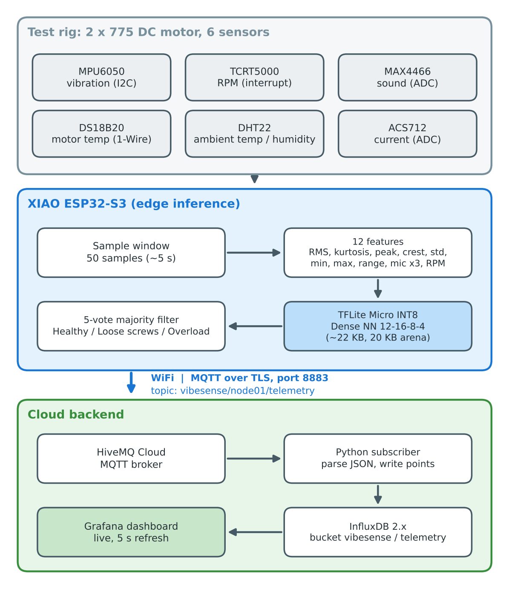

# VibeSense Pro

Edge-ML predictive maintenance node. A XIAO ESP32-S3 reads 6 sensors on a small motor test rig, classifies the motor's condition **on the device** with a quantized TinyML model, and streams the result over MQTT/TLS to a cloud dashboard.


> **Status: working prototype (v1).** End-to-end pipeline works: sensors → on-device inference → MQTT → InfluxDB → Grafana. No custom PCB yet.

**Demo video:** <paste LinkedIn post link here>

## What it does

- Reads vibration, RPM, sound, motor temperature, ambient temperature/humidity and current.
- Every 50 samples it computes 12 features, runs an INT8 neural network with TensorFlow Lite Micro, and applies a 5-vote majority filter.
- Detects 3 states on the rig: **Healthy**, **Loose screws (looseness)** and **Overload**.
- Publishes telemetry to HiveMQ Cloud over MQTT/TLS; the backend stores it in InfluxDB and shows it in Grafana.

## Architecture



`Sensors → XIAO ESP32-S3 (feature extraction + TFLite Micro) → WiFi/MQTT (TLS) → HiveMQ Cloud → InfluxDB → Grafana`

## Hardware

| Part | Purpose |
|---|---|
| XIAO ESP32-S3 | MCU, WiFi, TinyML inference |
| MPU6050 | Vibration (accelerometer, ±16 g) |
| TCRT5000 | RPM (IR reflective, interrupt-based) |
| MAX4466 | Sound level |
| DS18B20 (waterproof) | Motor temperature |
| DHT22 | Ambient temperature / humidity |
| ACS712 | Current sensing (see limitations) |
| 2 × 775 DC motors, BTS7960 (IBT-2) drivers | Test rig |

**Pin map:** A0 = ACS712, A1 = MIC, D2 = DHT22, D3 = DS18B20, D4 = SDA, D5 = SCL, D6 = TCRT5000.


## ML

- **Features (12 per window):** RMS, kurtosis, peak, crest factor, std, min, max, range, mic mean/std/max, RPM.
- **Model:** Dense NN 12→16→8→4, INT8 post-training quantization, about 22 KB, 20 KB tensor arena.
- **Results**
  - CWRU benchmark: 99.97% at 12 kHz dropped to 53.97% when downsampled to 3.2 kHz (our sensor's real bandwidth). Adding FFT-band features recovered 88.44%.
  - Own rig data (Motor A): XGBoost 99.62% (benchmark only), Dense NN 96.18%, INT8 TFLite 96.56% on a held-out split from a single session.

## Limitations (honest)

- **Live accuracy is lower than test accuracy.** The test split comes from a single recording session; sensor placement, TCRT alignment and session-to-session drift hurt live predictions.
- Unbalance is not reliable live and is not part of the demo.
- ACS712 is unreliable at the low current of these motors; current is not used in the model.
- Training data is from one motor and a limited number of sessions.

## Repository layout

- `sensors/` – Arduino firmware for the final build (sensors + TFLite + WiFi/MQTT), CSV logger
- `ml/` – training notebooks, datasets, model files
- `rig/`, `hardware/` – test rig and hardware notes
- `cloud/`, `dashboard/` – MQTT contract and Grafana dashboard (backend by Shweta)
- `docs/` – report, diagrams, images
- `firmware/` – earlier ESP-IDF attempt (archived; the project moved to Arduino IDE)

## Run it

1. Install Arduino IDE with the ESP32 core. Libraries: `Chirale_TensorFlowLite`, `PubSubClient`, `DHT sensor library` (Adafruit), `OneWire`, `DallasTemperature`.
2. Copy `sensors/secrets.example.h` to `sensors/secrets.h` and fill in your WiFi and HiveMQ credentials (`secrets.h` is git-ignored).
3. Open the sketch in `sensors/`, select the XIAO ESP32-S3 board, upload.
4. Open Serial Monitor at 115200 baud to see features and predictions.

## MQTT

Topic: `vibesense/node01/telemetry` (about every 5 s while RPM > 200)

```json
{"dev":"node01","ts":123456,"cls_name":"MotorA_Healthy","vib":1.23,"rpm":9840.0,"mic":1100.0,"curr":0.0}
```

Full contract: `cloud/` (credentials are shared privately, never in this repo).

## Next

Multi-session training data, more fault types (unbalance), custom PCB (KiCad), alerting and historical trend storage.

## Team

- Harshit Jaiswal – hardware, firmware, ML
- Shweta – backend (InfluxDB, Grafana)

B.Tech ECE, Techno India University.
